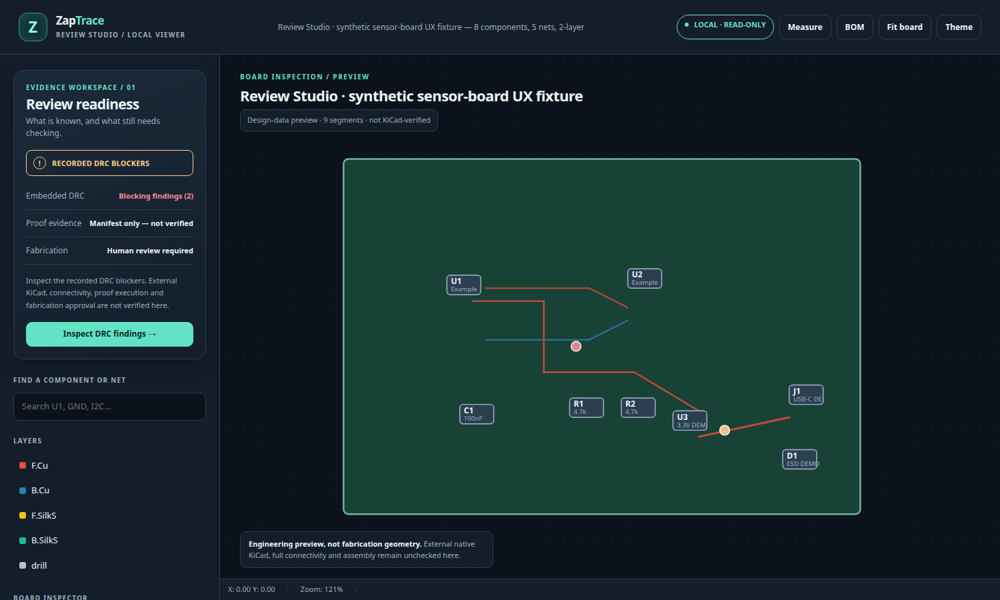

# ZapTrace Review Studio — interactive UX fixture

**SYNTHETIC VISUAL TEST DATA — NOT AN ELECTRONIC DESIGN.** All positions, routing
segments, component footprints (`DEMO-ONLY`), and two `UX-EXAMPLE-*` DRC records
are invented solely to exercise the user interface. They are **not native KiCad
ERC/DRC**, routed-net continuity, engineering calculations, simulation, supplier
approval or a fabrication-ready PCB. Never export these as production assets.

A *real, executable* browser preview of the current Review Studio can be made
locally, without accounts, network requests, or cloud uploads:

```bash
zaptrace view examples/review_studio_ux_fixture/design.yaml \
  --proof examples/review_studio_ux_fixture/proof.yaml \
  --output build/review-studio-demo --open
```

Or open `build/review-studio-demo/index.html` manually. The HTML and adjacent
`viewer-data.json` are inspect-only local artifacts. If running from a source
checkout, use the repository CLI environment (`uv run zaptrace ...`).



## Try these interactions

1. Notice **Recorded DRC blockers (2)**, **Manifest only — not verified**, and
   **Human review required**. The manifest intentionally carries the misleading
   `status: pass` field to ensure the UI does **not** treat configuration as an
   executed Proof Pack.
2. Select **Inspect DRC findings**. The UI switches to the DRC tab, resets the
   search filter and focuses the findings list. Click a finding to pan to its
   *synthetic* coordinate and inspect its message.
3. Switch to **Parts**, search `U2`, and select it. Switch to **Nets**, choose
   `I2C_SDA`, then toggle `F.Cu` and `B.Cu` with the keyboard or mouse.
4. Inspect **BOM**, toggle the theme, measure two points and fit the board.
5. Compare against `examples/esp32_i2c_sensor_node/design.yaml` from `main`:
   this unplaced, unrouted source correctly shows an **empty outline** and
   explains that placement and route evidence are missing. It does **not**
   invent 0,0 component positions or claim the PCB is cleared for production.

The UI is a **focused inspect/review workbench**, not a CAD editor, production
approval service, or AI chat-to-board implementation. Real external KiCad,
Proof Pack execution, connectivity, electrical/RF validation, DFM and qualified
human manufacturing review are independent future evidence inputs.

See [Review Studio product contract](../../docs/product/review-studio.md) and
[Issue #31](https://github.com/oaslananka/zaptrace/issues/31).
